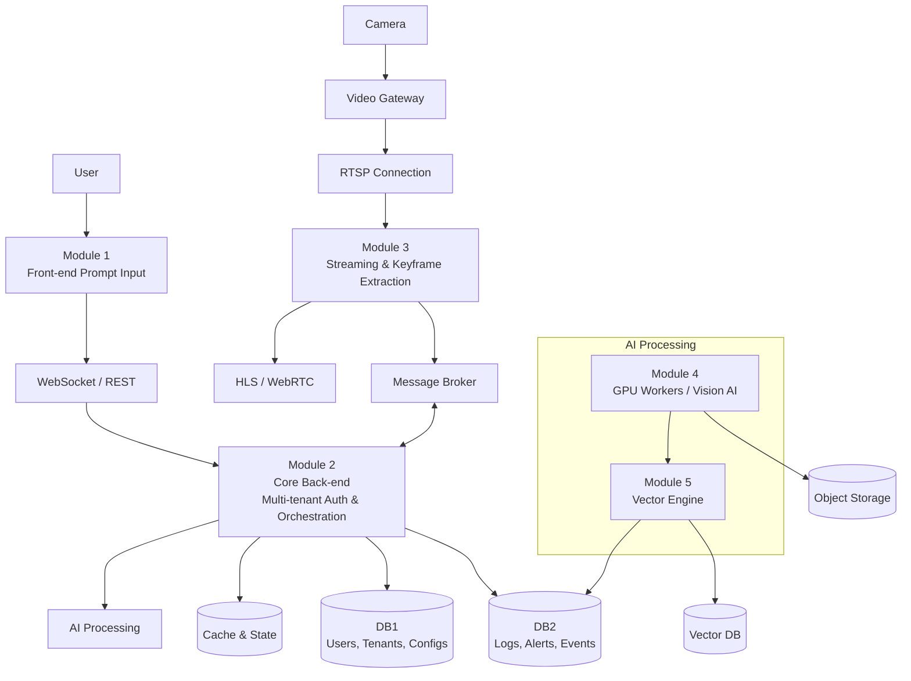

<p align="center">
  
</p>

# FallGuard Vision

FallGuard watches your security cameras and tells your team **when someone falls and stays
down**. It shows the cameras live, raises an alert within seconds of a fall, lets staff
respond and take notes, sends email and text messages, and helps you fill in the incident
report afterwards.

It is built for organizations such as care homes, clinics and workplaces: several people
from the same organization sign in and share the same cameras, events and settings.

This page has two parts:

- **[Part 1 — For users](#part-1--for-users)**: what FallGuard does and how to use it. No
  technical knowledge needed.
- **[Part 2 — For engineers](#part-2--for-engineers)**: architecture, services, how the
  features work inside, configuration and testing.

---

# Part 1 — For users

## Why FallGuard

**Purpose: reduce the liability and losses a business faces when someone falls on its premises.**

In Ontario, a fall is a legal risk as well as a safety risk:

- **Visitors, customers, patients and students** can sue under the *Occupiers' Liability Act*,
  which requires reasonable care to keep people safe on the premises.
- **Workers** are covered by the *Occupational Health and Safety Act* (OHSA). Maximum fines are
  **$2 million** per corporation and **$1.5 million** for directors and officers. The WSIB
  Form 7 is due within **3 business days**; late reports cost $250, or $1,000 after 30 days.
- **Falls are common and costly:** about **1 in 5** allowed WSIB lost-time claims are falls
  (20.6% in 2018), WSIB paid **$2.64 billion** in claims in 2024, and lost-time claims were
  up **6%** in Q4 2025 compared with Q4 2024.

FallGuard helps a business show it took reasonable care:

| What courts and regulators look for | What FallGuard provides |
|---|---|
| Quick response | An alert within seconds, escalating at 1 and 5 minutes, by app, email and SMS |
| An evidence trail | A timestamped event with photo, video, who responded, notes and an activity log |
| Timely reporting | WSIB Form 7, OHSA notice and OSHA 301 drafts filled in from the event |
| Corrective action | Analytics by camera and zone show where falls keep happening |

A system alone is not a defence: staff still need to respond and fix hazards. This is
background, not legal advice.

Sources: [Occupiers' Liability Act](https://www.ontario.ca/laws/statute/90o02) ·
[OHSA penalties](https://www.ontario.ca/document/guide-occupational-health-and-safety-act/part-ix-offences-and-penalties) ·
[WSIB Form 7 guide](https://wsib.ca/en/employers-report-injury-disease-form-7-reference-guide-businesses) ·
[Ontario falls inspection blitz](https://www.ontario.ca/page/inspection-blitz-results-slips-trips-and-falls) ·
[WSIB 2024 Annual Report](https://www.wsib.ca/sites/default/files/2025-11/2024_annual_report_20250429_final_with_signatures.pdf) ·
[WSIB corporate reports](https://www.wsib.ca/en/corporate-reports)

## What FallGuard does

| Feature | What it means for you |
|---|---|
| **Live View** | See all your cameras at once. Every person in view has a box around them and a label: standing, falling or lying down. |
| **Fall alerts** | When someone falls and stays down for a few seconds, the app sounds an alarm, shows "1 person down" at the top, and can send email and text messages. |
| **Fall Events** | A list of every fall: when, where, which cameras saw it, which person (the detector's number, e.g. #6, to tell two people apart), how long the person was down, a photo and a video of the whole fall (from 15 seconds before, until 10 seconds after they are back up). Staff can acknowledge, resolve or mark a false alarm, and add notes. |
| **Analytics** | Charts of falls over time, by camera and by zone. |
| **Reports & Export** | Download falls and the activity log as spreadsheets, and print or save incident reports as PDF. |
| **Incident reports** | Fill in a WSIB Form 7, an Ontario Ministry of Labour notice, an OSHA 301 or an internal report. FallGuard fills in everything it already knows. |
| **Notifications** | Choose who gets told about falls, by app, email or text message, depending on how serious the fall is. |
| **Members & Roles** | Invite your team and decide what each person is allowed to do. |
| **Cameras** | Add, rename, pause or remove cameras and choose the order they appear in. |
| **Detection Settings** | Fine-tune how the fall detector works (most people never need to change these). |

## Getting started

### Step 1. Install FallGuard (done once, by whoever sets it up)

Someone with access to the computer or server follows **[GETTING_STARTED.md](GETTING_STARTED.md)**.
It takes 10–20 minutes the first time. When it is done, the app opens in a web browser at
**http://localhost:3000** (or the address your administrator gives you).

### Step 2. Create your organization

1. Open the app and click **Create an organization**.
2. Fill in your **organization name**, your **first and last name**, your **work email** and a
   **password** (at least 10 characters, with letters and a number or symbol).
3. FallGuard sends you an email with a link. **Open the link to verify your email.** You can't
   sign in until you do. The link works for 48 hours. (For demos, the installation can switch this
   step off: you are then signed in straight away.)

You are now the **admin** of your organization.

> **The very first person to sign up takes over the cameras already connected to this
> installation.** Anyone who signs up after that gets a new, empty organization. To join an
> existing organization, ask its admin for an invitation instead of signing up.

> **No email arrived?** Check your spam folder, or use "send it again". If your installation
> has no email server set up yet, the email isn't sent: your administrator can find the link
> in the server log (see [Questions and problems](#questions-and-problems)).

### Step 3. Set things up (first-time checklist)

Do these once, in this order. Each one takes a few minutes.

1. **Settings → Organization**: your address, phone number and, if you are in Ontario, your
   WSIB firm number. These appear on incident reports.
2. **Settings → Time zone**: so every time in the app matches your clock.
   **Settings → Appearance** also sets the organization's default look (light, dark, or the
   same as each device). Everyone sees it until they pick their own with the light / dark
   button at the top of every page (left of the bell; the sign-in page has one in the top right
   corner too).
3. **Cameras → Add camera**: the camera's address (it starts with `rtsp://`), plus its
   username and password if it has one. Give each camera a location ("2nd floor hallway")
   and a zone (cameras that look at the same area).
4. **Notifications**: choose who gets an email or a text message for each level of fall,
   and connect your email and text-message services (see [Notifications](#notifications)).
5. **Members & Roles → Invite someone**: invite your team with the right role (see
   [Roles](#roles-who-can-do-what)).

## Signing in and your account

- **Sign in** with your work email and password.
- **Forgot your password?** Click "Forgot your password?" on the sign-in page. You get an email
  with a link to choose a new one (it works for 1 hour). Changing it signs you out on every
  other device.
- **Too many wrong passwords:** after 5 wrong tries in a row, the account is locked for
  15 minutes. Wait, or reset your password.
- **One account per email.** You can't create two accounts with the same email address.
- **My account** (click your name at the top right): change your name, add your mobile number
  (needed if you want text messages), change your password, sign out, or sign out of every
  device at once.
- **More than one organization?** If you were invited to several, switch between them from the
  menu under your name.
- **Leave an organization** from My account. You lose access until someone invites you again.

## Roles: who can do what

Every person in an organization has one of three roles.

| Role | In short | What they can do |
|---|---|---|
| **Admin** | Full control | Everything, including inviting and removing people, changing their roles, and deciding what members and viewers may do. |
| **Member** | Runs the day-to-day | Everything an admin can, **except** inviting, removing or changing the role of other people. |
| **Viewer** | Read-only | Watch the live cameras and look at fall events, reports and logs. Can't change anything. |

The full list, as shown on the **Members & Roles** page:

| Permission | Admin | Member | Viewer |
|---|:-:|:-:|:-:|
| View live cameras | ✓ | ✓ | ✓ |
| View fall events (photos, clips) | ✓ | ✓ | ✓ |
| View analytics | ✓ | ✓ | ✓ |
| View reports and download exports | ✓ | ✓ | ✓ |
| View logs | ✓ | ✓ | ✓ |
| View members | ✓ | ✓ | ✓ |
| Respond to alerts (acknowledge, resolve, false alarm, notes) | ✓ | ✓ | |
| Write incident reports | ✓ | ✓ | |
| Manage cameras and their layout | ✓ | ✓ | |
| Change detection settings | ✓ | ✓ | |
| Manage notifications | ✓ | ✓ | |
| Manage organization settings | ✓ | ✓ | |
| View emails sent (Settings) | ✓ | | |
| Invite and remove members, change roles | ✓ | never | never |
| Change what members and viewers may do | ✓ | never | never |

**Admins can change this table.** On **Members & Roles**, tick or untick boxes in the Member and
Viewer columns, then click **Save permissions**. For example, you can let viewers respond to
alerts but not change cameras. "Reset to defaults" puts the table back as shown above.

A few rules always apply:

- Admins can always do everything.
- Only admins can invite, remove or change the role of people. To share that, make someone
  else an admin.
- **An organization always keeps at least one admin.** The last admin can't remove themselves
  or change their own role.
- When an admin removes someone or changes their role, it takes effect straight away. A removed
  person is signed out at once. If they aren't in another organization, their account is
  deleted: to come back they need a new invitation and sign up again.

### Inviting your team

1. **Members & Roles → Invite someone**: type their email and pick a role.
2. They get an email with a link (valid for 7 days). The page also shows you the link and a **QR
   code**, so you can share it directly or let them scan it with a phone. They choose a password and they're in.
   Opening the link also confirms their email, so they don't need a second verification email.
3. If they already have a FallGuard account (for another organization), they just enter their
   password to join yours.
4. Invited people appear in the **Members** list as **Invited** until they accept: **Resend**
   sends a new link (the old one stops working), **Cancel** withdraws the invitation.

### Letting visitors look around (temporary access links)

For a demo you can let people in **without an account**:

1. **Members & Roles → Temporary access links**: give the link a name (for example "Demo day") and choose
   how long it works: 12 hours, 1, 3, 7, 14 or 30 days.
2. Copy the link, or let people **scan the QR code** with their phone camera (Download QR saves it
   for a slide or a printout). For safety it is shown only once; if you lose it, make a new one.
3. Anyone who opens it goes straight in, **view-only**: they can watch the cameras and look at fall
   events, analytics, reports and logs. They can't change anything, can't respond to alerts and
   can't see the members list.
4. When the time is up, everyone using the link is out. **End now** stops it early. The list shows
   how many times each link was opened.

Only admins can create temporary access links.

## Gateways

A gateway connects your cameras to FallGuard. An **on-site gateway** runs on a computer next to
the cameras (at your facility); the **Cloud** gateway runs on the server and can only take phone
cameras. The app uses one gateway at a time.

- **Settings → Gateways** lists them, online or offline, with how many cameras each has. Give
  each one a name (where it is, e.g. "Office server") and a location.
- **Gateway in use:** *Automatic* (recommended) uses an on-site gateway whenever one is online,
  and the Cloud gateway otherwise. An administrator can also select a gateway; it remains in
  use while offline.
- The **Cameras** page shows the gateway in use. With an on-site gateway you add cameras with
  **Add camera**; with Cloud, only **Add phone camera** is shown.
- Cameras belong to the gateway they were added on. Cameras assigned to a gateway that isn't in
  use are shown as **Inactive** and reconnect automatically when that gateway is selected.
- **Remove** forgets a gateway that's no longer used, optionally with its cameras.

## Phone cameras (demo option)

For demos on the cloud server, a phone can stand in for a camera, on any Wi-Fi or mobile data.
This is a temporary option: it may be removed once cameras connect through an on-site gateway.

1. **Cameras → Add phone camera**: give it a name (e.g. "Lobby phone"). Two QR codes appear.
2. On the phone, install **Streamza** (free, Android) and choose **Custom RTMP**.
3. Scan code 1 with the phone's camera, tap Copy, paste it into **Server URL**. Code 2 goes into
   **Stream key**.
4. Tap **Go Live**. The camera turns **online** in FallGuard within seconds.

Other apps work too ("Show other apps"): Larix Broadcaster imports its QR code, but its free
version adds a watermark. Streamza sends without encryption (fine for demos); Larix and OBS
can use the encrypted address.

Tips: keep the phone plugged in, screen on, in landscape. The QR code is shown once; lost it?
Use **New QR code** on the camera (the old one stops working). Removing the camera also cuts
the phone off. Each phone has its own password.

## Emails sent

**Settings → Emails sent** lists the invitations, email checks and password resets FallGuard
sent, and whether the email server accepted them. If someone didn't get an email, check their
spam folder. Admins see it; they can let members or viewers see it on **Members & Roles**.

## Notifications

### How serious is a fall?

Every fall has a **severity**, which rises the longer the person stays on the ground:

| Severity | When |
|---|---|
| **Medium** | The fall is confirmed (the person stayed down for a few seconds) |
| **High** | Still down after 1 minute |
| **Critical** | Still down after 5 minutes |

Each time a fall reaches a new level, FallGuard sends a new message to the people who asked for
that level. Someone who only wants "Critical" is only contacted if the person is still down after
5 minutes.

### Choosing who is told, and how

On the **Notifications** page:

1. **When to notify**: a table with the three severities across the top and three ways to
   notify down the side. Tick a box to use that way at that severity.
   - **In-app**: the alarm sound, the bell at the top and a pop-up on the screen of everyone
     signed in.
   - **Email**: sent to the email recipients below.
   - **SMS**: a text message to the SMS recipients below.
2. **Email recipients** and **SMS recipients**: add people from your team (their email or the
   mobile number in their account) or type any address or number. Each person has their own
   boxes for Medium, High and Critical, so the night nurse can get everything while the manager
   only gets critical falls. Mobile numbers use the international format, e.g. `+14165550123`.
3. **Follow-up updates** (optional): also tell the same people when
   - the person got back up,
   - an operator marked the alert a false alarm,
   - an operator resolved the alert.
4. **Message templates**: use the **default** messages, or choose **Custom** and write your own.
   Words in double curly brackets are filled in for you, for example `{{camera}}`, `{{location}}`,
   `{{time}}`, `{{severity}}` and `{{link}}` (a link to the fall in the app). Click **Preview** to
   see an example.
5. Click **Save changes**.

### Connecting email and text messages

Each card shows whether it is **Sending** or **Off**. While off, alerts are not sent (only noted
in the server log, for testing).

- **Email**: pick **FallGuard's email** (nothing to set up), or **Your own email server** with the
  details from your IT team (for example Microsoft 365: `smtp.office365.com`, port 587,
  STARTTLS). Click **Send test email** to check it works.
- **Text messages (SMS)**: pick **Twilio account** and paste your Twilio account SID, auth token
  and phone number. Click **Send test SMS**.
- Passwords and tokens are stored encrypted and are never shown again.
- **Recent messages** at the bottom shows every email and text sent, and whether it worked.

## When a fall happens

1. The alarm sounds, the bell shows the alert, and "1 person down" appears at the top. The
   people you chose get an email or text.
2. Open the alert (from the bell or **Fall Events**). You see the photo, the video, which cameras
   saw it and how long the person has been down. One fall = one event per person: if the camera
   loses sight of someone on the floor (for example behind another person), the event stays open
   and its severity keeps rising until they are seen getting up.
3. **Acknowledge** it so your team knows someone is on it.
4. When it's handled, **Resolve** it, or mark it a **False alarm** if nobody fell. Both can be
   undone if clicked by mistake.
5. Add **notes** (what happened, who helped). Notes are never overwritten, and each one shows who
   wrote it and when.

Everything is recorded in the activity log with the name of the person who did it.

## Incident reports

Some falls must be reported to the government or your insurer. FallGuard prepares the report
from what it recorded, so you only fill in what it can't know.

**To create one:** open the fall in **Fall Events** → **Incident reports** → **Create incident
report**, and choose a form:

| Form | Use it for | Deadline |
|---|---|---|
| **WSIB Form 7** (Ontario) | A worker hurt at work who needed health care, lost time or was on modified work | Within 3 business days of learning about it |
| **OHSA notice** (Ontario Ministry of Labour) | A critical injury or death (s.51), or an injury that stops a worker from doing their usual work (s.52) | s.51: phone immediately, written report within 48 hours. s.52: within 4 days |
| **OSHA 301** (United States) | A recordable work injury; also produces the OSHA 300 Log entry | Within 7 days |
| **Internal report** | Any fall, including residents, patients and visitors: what happened, the cause, and what you'll change | As your policy requires |

**What FallGuard fills in for you** (marked "Auto-filled"): the date and time, where it happened
(location, zone, camera), how long the person was down, who acknowledged and resolved the alert
and when, the staff who responded, the notes, the video and photo evidence, your organization's
details and your name as the person preparing it.

**What you fill in** (marked "Needs input"): details about the injured person, the injury,
medical care, witnesses not in the system, and what you'll do to prevent it happening again.

Then:

- **Save draft** to come back later. **Refresh from records** updates the auto-filled parts (for
  example after the person recovered) without touching what you typed.
- **Mark as final** when it's complete. It records who finalized it and when. A final report can
  be reopened if it needs changing.
- **Print / save as PDF** for a clean copy with a signature line.
- All reports are listed under **Reports & Export**. The filters at the top (time window, status, place...)
  pick them by **when the fall happened**. Print or save one report, or **all listed reports at once**
  (each on its own pages), as PDF; download the **OSHA 300 Log**.

> FallGuard's report is a completed summary to **copy into, or attach to, the official form**
> (for example WSIB's online eForm 7). Always check every answer before you submit it.

## Questions and problems

| Question | Answer |
|---|---|
| I signed up but didn't get the email | Check spam, or click "send it again" on the sign-in page. If no email server is connected yet, ask your administrator: the link is in the server log (`docker compose logs api \| grep -A3 "email:log"`). |
| A temporary access link says it expired | Its time ran out or an admin ended it. Ask for a new link. |
| I signed up and my organization is empty | Someone else signed up first and took over this installation's cameras. Ask them to invite you instead. |
| "Your role doesn't allow this" | Your role doesn't include that action. Ask an admin. |
| Another organization can't add cameras | For now, only the organization that signed up first is connected to the camera gateway. |
| Locked out after wrong passwords | Wait 15 minutes, or use "Forgot your password?". |
| Text messages or emails don't arrive | Notifications → check the provider with **Send test**, then check **Recent messages** for the error. |
| No sound when a fall happens | Click the bell and **Turn on alarm sound**: browsers need one click before a page may play sound. |
| Is the server running out of space or memory? | **Settings → System status** shows memory, storage and incident videos as bars (amber from 75%, red from 90%). If storage fills up, keep videos for fewer days or add disk space; if memory stays high, use a larger server. |

---

# Part 2 — For engineers

## Architecture

```
camera (RTSP) ─► gateway-back :8080 ─► stream-hub :8090 ─► ml-service :9999 ─► db :5432
                                           └─► browsers over WebSocket :9000 (via nginx /stream-hub, session-checked)
browser ─► fallguard-frontend (nginx) :3000 ─► api :8000 ─► db · gateway-back · stream-hub
                                                 └─► SMTP / Twilio (notifications)
```

| Service | Folder | Role |
|---|---|---|
| `frontend` | `fallguard-frontend/` | React (Vite) app served by nginx. Proxies `/api` to the API and `/stream-hub` to stream-hub (behind `auth_request` → `/api/auth/check`) |
| `api` | `backend-module/api/` | Go (Gin + pgx) REST API: accounts, roles, incidents, alerts, cameras (via the gateway), notifications, incident reports, exports. Runs the camera monitor and the notifier in the background |
| `db` | `backend-module/` | PostgreSQL 17 + pgvector. Tenant tables use row-level security; partitioned by month for events, alerts and logs |
| `ml-service` | `ml-service/` | Python pose model (YOLO) + fall rules; writes incidents, alerts and predictions. See [ml-service/README.md](ml-service/README.md) |
| `stream-hub` | `stream-hub/` | Go relay: gateway video → ml-service and browsers; records incident clips (the whole event, written to disk as it records; `max_s` safety cap, 1 h) and snapshots |
| `gateway-back` | `gateway-back/` (+ `gateway-ui/`) | Go edge gateway: connects to RTSP cameras, extracts keyframes, registers itself with the API |
| `test-camera` | root | Dev only: RTSP relay for a webcam or test video |

Ports, dev vs prod mode and Linux / WSL setup: [DOCKER.md](DOCKER.md). First run on a laptop:
[GETTING_STARTED.md](GETTING_STARTED.md).

The original platform design (the generic multi-tenant computer-vision platform FallGuard is
built on):



## Accounts, tenancy and RBAC

- **Organizations are tenants** (`tenants`). Users (`users`, one per email, CITEXT unique)
  belong to organizations through `memberships (tenant_id, user_id, role)`.
- **Home tenant**: the API's `TENANT` env (slug or UUID) owns the gateway and the ML pipeline.
  The first sign-up claims it (renames it; demo-seed placeholder members are dropped) if no
  member with a real password hash exists. Later sign-ups create new tenants
  (`<slug>-<6 hex>`). Gateway routes on other tenants return 409 `no_gateway`; their camera
  list skips the gateway.
- **Sessions**: random 32-byte token in an HttpOnly, SameSite=Lax cookie `fg_session`
  (`Secure` with `COOKIE_SECURE=true` or HTTPS); only its SHA-256 is stored in `sessions`.
  7-day sliding expiry. `requireAuth` puts the session's tenant on the request context
  (`store.WithTenant`), so every existing query runs for the signed-in organization, and the
  user on it (`store.WithActor`) for `audit_logs.user_id` / `details.actor`.
- **Passwords**: bcrypt cost 12, 10–72 bytes with letters and a digit/symbol. 5 failures →
  15-min lock; unknown emails take the same time and answer as wrong passwords. Reset links
  (1 h) and verification links (48 h) are single-use hashed tokens in `user_tokens`; a reset
  deletes all sessions, a password change deletes all others.
- **Invitations** (`invitations`): hashed token, 7 days, resend rotates the token, revoke;
  accepting creates a verified account or, for an existing account, requires its password.
- **Email verification switch**: `REQUIRE_EMAIL_VERIFICATION=false` skips the verification email
  and signs new accounts in at once (demos); only the exact value `false` turns it off. The
  sign-up page reads `GET /api/auth/config`.
- **Temporary access links** (`guest_links`, called demo links in the code): an admin picks a label and 1–720 hours; the link's token
  is shown once (hash stored). Each link has a hidden visitor user (`users.guest_link_id`, viewer
  member, `.invalid` email, no password, excluded from members, sign-in and resets). Opening
  `/demo/<token>` creates a session capped at the link's end; `SessionByToken` re-checks the link
  on every request, so expiry or "End now" cuts access immediately. Visitors' permissions are the
  viewer grants intersected with the read-only set (`auth.GuestGrants`); account self-service is
  refused (`notGuest`). Visitor users of links ended over 30 days ago are purged hourly.
- **CSRF**: SameSite=Lax plus a same-origin check on non-GET requests (`Origin` must match
  `Host` / `X-Forwarded-Host` or `ALLOWED_ORIGINS`). Per-IP rate limits on auth routes.
- **Permissions** (`internal/auth/perms.go`): every route has `s.can(perm)` or
  `s.canAny(...)`. Admin = all; member and viewer grants live in `tenants.role_permissions`
  (NULL = defaults) and are normalized (unknown and admin-only keys dropped).
  Admin-only: `members.manage`, `roles.manage`. Last-admin protection is enforced in the store
  under a row lock.

| Key | Default roles |
|---|---|
| `live.view`, `events.view`, `analytics.view`, `reports.view`, `logs.view`, `members.view` | admin, member, viewer |
| `alerts.manage`, `incident_reports.manage`, `cameras.manage`, `detection.manage`, `notifications.manage`, `settings.manage` | admin, member |
| `members.manage`, `roles.manage` | admin only (not grantable) |

The frontend mirrors this: `AuthProvider` loads `/api/auth/me` (re-checked every minute),
`RequireAuth` guards the app, navigation items and pages declare their permissions
(`config/navigation.ts`, `RequirePermission`), and buttons are hidden without the permission.
The backend is the authority; the UI only hides what would be refused.

## Notifications engine

- Settings per tenant in `notification_settings` (`config` JSON: matrix, recipients,
  follow-ups, templates, app URL; `email_provider` / `sms_provider` JSON with secrets sealed by
  AES-GCM using `APP_SECRET`, or a random key in `platform_secrets` when unset).
- `RunNotifier` (every 5 s) reads recent alerts of tenants with settings (never older than when
  notifications were first saved, at most 2 days):
  - an alert at a new severity → event `alert:<severity>`, messages to recipients of that
    severity whose channel is on in the matrix. Levels skipped between two checks are marked
    done without messages (no bursts);
  - follow-ups `recovered` (incident recovered), `false_alarm`, `resolved` → to everyone who got
    an `alert:*` message for that alert, if enabled.
  - `notification_events (alert_id, event)` makes each event fire once;
    `notification_deliveries` holds every message with status `pending / sent / logged / failed`,
    retried after 1, 5 and 15 min (4 attempts).
- Senders (`internal/notify`): SMTP (STARTTLS / implicit TLS / none, PLAIN auth), Twilio REST,
  or `log`. Test endpoints can test unsaved settings.
- In-app: `GET /api/notifications` drops severities switched off for `app`.
- Account emails (verification, reset, invitation) use `SMTP_*` env, else the tenant's (or home
  tenant's) SMTP provider, else the log. `EMAIL_LINKS_IN_RESPONSE=true` returns the links in
  API responses when nothing is sent (demos only).

## Incident reports

- `GET /api/incidents/:id/report-facts` assembles the incident, its cameras (snapshots, clips),
  activity log, notes, prediction count, model, organization profile (`tenants.profile`) and
  the preparer.
- Form definitions live in the frontend (`features/incident-reports/forms.ts`): sections and
  fields, each optionally with an `auto(facts)` filler, plus `required`, deadline and disclaimer.
  The draft is created with the auto-filled values and the list of auto-filled keys; editing a
  field removes it from that list, so "Refresh from records" only overwrites untouched fields.
- Stored in `reports` (`form`, `status` draft / final, `content` JSON, `created_by`,
  `reviewed_by/at` = finalized by/at). Every create / save / delete is in the incident's
  activity log. Printing uses a print-only layout (`@media print`).

## Configuration

All settings are in the root `.env` (copy `.env.example`; every option is explained there).
Account and notification settings: `APP_URL`, `APP_SECRET`, `COOKIE_SECURE`,
`REQUIRE_EMAIL_VERIFICATION`, `EMAIL_LINKS_IN_RESPONSE`, `ALLOWED_ORIGINS`, `SMTP_HOST` / `SMTP_PORT` / `SMTP_SECURITY` /
`SMTP_USERNAME` / `SMTP_PASSWORD` / `SMTP_FROM` / `SMTP_FROM_NAME`.

Database changes are additive migrations run by the API at every start
(`internal/store/settings.go`, `internal/store/migrations_accounts.go`); `db/schema.sql` has the
same tables for fresh installs.

## API reference

Every route, its permission and its payload: [backend-module/api/README.md](backend-module/api/README.md).

## Testing

| What | How |
|---|---|
| Backend unit tests (permissions, passwords, tokens, templates, validation, encryption, Twilio client) | `cd backend-module/api && go test ./...` |
| Frontend type check and build | `cd fallguard-frontend && npm run build` (lint: `npm run lint`) |
| ML service | `cd ml-service && pytest` (see its README) |
| End to end | Run the stack, then sign up, verify (link in `docker compose logs api`), invite a member and a viewer, check their permissions, save notifications, and create a report from a fall event |

## Known limitations

- ml-service and gateway-back serve the home tenant only; other organizations can sign in and
  configure everything but can't connect cameras yet.
- The app uses one gateway at a time (Settings → Gateways): cameras on the others wait until
  their gateway is used again.
- Gateways register with the API without a password (`POST /api/gateway/add`, accepted only
  from the server or its private network); a per-gateway registration key is to do.
- stream-hub's HTTP port (9000) is still published on the host, which bypasses the nginx
  session check; bind it to `127.0.0.1` in production.
- The API connects to PostgreSQL as the table owner (row-level security is not forced); a
  restricted role is a later step.

## Future improvements

- **Model training opt-in (screen only so far).** Settings → *Help improve fall detection* lets an
  admin opt in, after a confirmation that lists the main risks (privacy of the people filmed,
  longer storage, training already done can't be undone). Today the choice is kept in that
  browser only and nothing is collected. To build:
  - store the choice per organization (`tenants`: opted in, by whom, when) with an API route
    and an audit log entry, admins only;
  - while opted in, keep each incident's clip plus its review outcome (false alarm, resolved,
    recovered, notes) in a separate training store, outside normal clip retention;
  - delete it after 2 years at most, or once the training run that used it is finished;
    opting out deletes what was kept and stops collection;
  - feed it to `ml-service/model_finetuning/` (false alarms as negatives, confirmed falls as
    positives).

## Branding

Logo files live in `fallguard-frontend/public/brand/` (light and dark versions of each). The app
uses them through `components/ui/Brand.tsx`: `BrandLogo` (horizontal in the header and on sign-in
pages, stacked on the loading screen), `BrandMark` (the C4 icon on narrow screens and as the
favicon) and `PoweredBy` (Xcelerate Industries, the company behind FallGuard, in the footer and
under the sign-in card). Printed reports always use the light logo.

Theme: each browser's own choice wins; otherwise the organization's default
(`tenants.default_theme`, `PUT /api/settings/theme`, remembered in the browser so the sign-in
page matches); otherwise light. `effectiveTheme` in `store/uiStore.ts`, applied in `App.tsx` and
before the first paint in `index.html`.

## More documentation

| Document | Covers |
|---|---|
| [GETTING_STARTED.md](GETTING_STARTED.md) | Installing and running on Windows or Mac |
| [DOCKER.md](DOCKER.md) | Services, ports, Linux / WSL, day-to-day commands |
| [backend-module/api/README.md](backend-module/api/README.md) | API routes and backend internals |
| [backend-module/db/README.md](backend-module/db/README.md) | Database schema |
| [ml-service/README.md](ml-service/README.md) | Fall detection |
| [fallguard-frontend/docs/ARCHITECTURE.md](fallguard-frontend/docs/ARCHITECTURE.md) | Frontend structure |
| [stream-hub/README.md](stream-hub/README.md) · [gateway-back/README.md](gateway-back/README.md) | Video relay and camera gateway |
